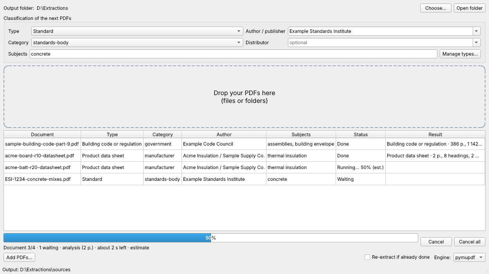
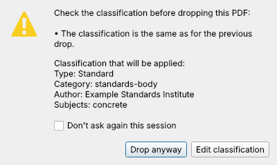
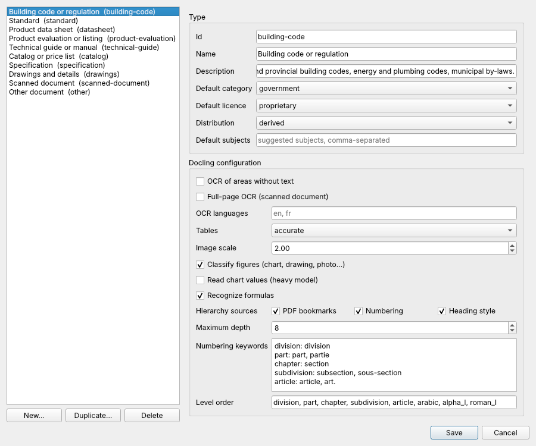

# Quarrix

<p align="center">
  
</p>

**Quarrix** extracts the raw material of PDF documents, the way stone is cut from a
quarry. Drop PDFs into a window and Quarrix extracts their text, tables and figures
(charts included) **while keeping the original heading hierarchy**. It writes
everything to the folder of your choice, in a format designed to serve as reference
material for an AI such as Claude: readable Markdown, structured JSON with the
section outline, tables as CSV and figures as PNG.

- Two engines: **Docling** (AI layout analysis, recommended) and **PyMuPDF** (fast, no model).
- Each document is classified (category, author, type, subjects); each document
  type has its own Docling configuration.
- Provenance and licence per document, and a **distributable pack** that only
  includes derived content when the source is protected by copyright.

```
 PDF ──► [ Quarrix ] ──► <output folder>/sources/<doc>/   full extraction (internal use)
                                 │   + derived/   values, formulas, summaries you write
                                 ▼
                      quarrix dist ──► quarrix-pack/   distributable pack
```

The output folder can be a plain folder or a Git repository (private if the
documents are protected); the pack can be copied to another, public repository.

Two ways to use it:

| | Windows `.exe` | Python install |
|---|---|---|
| Setup | none, a single file | Python, virtual environment, `pip` |
| Engine | PyMuPDF (fast, no AI) | **Docling** (recommended, more accurate) + PyMuPDF |
| `quarrix` command line | no | yes (`extract`, `dist`…) |
| Updating | download the `.exe` again | `git pull` |

## Option A: the Windows executable

1. Download **`Quarrix.exe`** from the
   [`latest-build`](https://github.com/samagior/Quarrix/releases/tag/latest-build)
   pre-release (rebuilt automatically on every code change).
2. Put it anywhere (e.g. `C:\Users\<you>\Applications\`) and double-click it.
   The executable is not signed: if Windows SmartScreen shows "Windows protected
   your PC", click "More info" then "Run anyway". The first start takes a few
   seconds (unpacking).
3. On the first PDF drop (or with "Choose…" at the top of the window), pick the
   **output folder** where extractions are written. It is remembered.

The executable does not include Docling (several GB of models): for codes,
standards and complex documents, prefer option B.

## Option B: full Python install (with Docling)

Commands are for **Windows PowerShell**; macOS/Linux equivalents are given as
comments.

### 1. Prerequisites

- **Python 3.11, 3.12 or 3.13** from [python.org](https://www.python.org/downloads/).
  During installation, tick **"Add python.exe to PATH"**. Check: `python --version`
- **Git** from [git-scm.com](https://git-scm.com/downloads). Check: `git --version`
- About **5 GB** of free space (Docling, PyTorch and the models).

### 2. Clone the application

Clone into a local folder (not a folder synchronised by Syncthing, OneDrive, etc.:
the virtual environment must not be shared between computers).

```powershell
cd $HOME
git clone https://github.com/samagior/Quarrix
cd Quarrix
```

### 3. Create and activate the virtual environment

```powershell
python -m venv .venv
.venv\Scripts\Activate.ps1          # macOS/Linux: source .venv/bin/activate
```

The prompt should start with `(.venv)`. If PowerShell refuses to run the script
("running scripts is disabled on this system"), allow local scripts once, then
activate again:

```powershell
Set-ExecutionPolicy -Scope CurrentUser RemoteSigned
.venv\Scripts\Activate.ps1
```

### 4. Install Quarrix with Docling

Always **from the `Quarrix` folder**, with `(.venv)` active:

```powershell
python -m pip install --upgrade pip
python -m pip install -e ".[docling]"
```

Installing Docling downloads PyTorch and takes several minutes. For a light
install without Docling: `python -m pip install -e .` (PyMuPDF engine only).

Check the installation:

```powershell
quarrix config
```

**Docling models** (layout, tables) are downloaded automatically from Hugging
Face on the first extraction, only once; after that everything works offline.
To download them right away:

```powershell
docling-tools models download
```

### 5. Choose the output folder

Extractions go to the folder you choose: in the window ("Choose…", or
automatically on the first drop), or from the command line:

```powershell
quarrix init $HOME\Documents\Extractions
```

`init` remembers this folder as the destination and creates a `README.md`, a
`CLAUDE.md` (instructions for Claude) and a `.gitignore` in it, useful if the
folder is a Git repository. For a one-off run, `--output-dir FOLDER` overrides it.

### 6. Open the window

```powershell
cd $HOME\Quarrix
.venv\Scripts\Activate.ps1
quarrix-gui
```

`quarrix` with no argument or `python -m quarrix gui` also open the window. To
start it without activating the environment (a desktop shortcut, for example),
the target can be:
`C:\Users\<you>\Quarrix\.venv\Scripts\quarrix-gui.exe`

In the window, the "Engine" menu should show `auto` or `docling`.

### 7. Update

Close the window, then:

```powershell
cd $HOME\Quarrix
git pull
.venv\Scripts\Activate.ps1
python -m pip install -e ".[docling]"   # only if dependencies changed
quarrix-gui
```

### Troubleshooting

| Message | Cause and fix |
|---|---|
| `quarrix : The term 'quarrix' is not recognized` | environment not activated or incomplete install: `.venv\Scripts\Activate.ps1`, then `python -m pip install -e ".[docling]"` from the `Quarrix` folder |
| `does not appear to be a Python project` | `pip install -e .` run outside the `Quarrix` folder: `cd $HOME\Quarrix` first |
| `ModuleNotFoundError: No module named 'tomli_w'` (or another module) | interrupted install: run `python -m pip install -e ".[docling]"` again |
| `python` opens the Microsoft Store | Python is not on the PATH: reinstall from python.org and tick "Add python.exe to PATH" |
| Docling fails on the first extraction | no Internet access to download the models: Quarrix falls back to PyMuPDF; try again once online or run `docling-tools models download` |

## Usage

Set the classification in the "Classification of the next PDFs" panel, then drop
one or more PDFs (or a folder). A progress bar shows the percentage and estimated
time left for the current document; "Cancel" stops that document and "Cancel all"
also clears the queue. With Docling, which analyses a document in one go, the
percentage is an estimate based on the page count and the speed measured on your
computer (it gets better with each extraction). Double-click a row to open its
result folder. A PDF that was already extracted (same SHA-256 fingerprint) is
skipped unless "Re-extract if already done" is ticked.

## Classifying documents

Each document is classified along four axes, chosen in the "Classification of the
next PDFs" panel before dropping files:

1. **Category**: government, organization, standards body, manufacturer,
   distributor, professional, education, other;
2. **Author / publisher** and **distributor** (free text, with values already used);
3. **Document type**: building code, standard, product data sheet, product
   evaluation, technical guide, catalog, specification, drawings, scanned
   document, other. **Each type has its own Docling configuration** (OCR, table
   mode, figure classification, formulas, heading numbering keywords…);
4. **Subjects**: free list (building envelope, assemblies, fire safety…).

The type also suggests the default category and licence status (a code or a
standard is `proprietary`, so only derived data is distributed).

The classification applied to each PDF is shown in the list (Type, Category,
Author, Subjects columns). When you drop files, a warning asks for confirmation
if the type is still "other", if the author is empty, or if the classification is
the same as for the previous drop (forgot to change it between two batches).
"Edit classification" cancels the drop; "Don't ask again this session" turns the
warning off for a series of documents from the same author.

<p align="center">
  
</p>

"Manage types…" opens the editor: create, duplicate or delete a type and set its
Docling configuration.

<p align="center">
  
</p>

The suggested types, categories and subjects are saved in
`<output folder>/types.toml`, created on first launch from
[`quarrix/default_types.toml`](quarrix/default_types.toml): the classification is
versioned with the data. The defaults are geared towards technical documents in
the construction field; adapt them to your own domain. Dropping an already
extracted PDF again only updates its classification, without re-extracting it.

## Command line

```bash
quarrix extract docs/*.pdf          # extract without the window
quarrix extract code.pdf --type building-code --author "Example Code Council" --subject assemblies
quarrix classify <id> --subject "thermal insulation"   # reclassify without re-extracting
quarrix list --type building-code   # filter by --type, --category, --author, --subject
quarrix types [building-code]       # list types or show one configuration
quarrix extract folder/ --force     # a whole folder, re-extracting
quarrix dist                        # builds <output>/dist/quarrix-pack(.zip)
quarrix dist --publish-dir ~/pack   # … and copies it to another folder (e.g. a public repository)
quarrix --output-dir D:/extracts extract a.pdf   # another output folder, one-off
quarrix config                      # shows the active configuration
```

## Extraction engines

| Engine | Strengths | Limits |
|---|---|---|
| **Docling** (default when installed) | AI layout analysis: reading order, heading levels (bookmarks, numbering, styles), complex tables, figures, optional OCR | heavy, slow first start |
| **PyMuPDF** (fallback) | instant, no model | hierarchy from bookmarks or font sizes; borderless tables detected less reliably |

In `auto` mode, if Docling fails (for example offline before the models were
downloaded), Quarrix falls back to PyMuPDF.

## Output

See [docs/FORMAT.md](docs/FORMAT.md). In short, for each PDF: `document.md`
(reading), `document.json` (structure), `meta.json` (provenance and licence),
`tables/*.csv`, `figures/*.png`.

## Copyright and distribution

See [docs/DISTRIBUTION.md](docs/DISTRIBUTION.md). The full extraction stays in
the output folder (keep it private if the documents are protected); only the
compiled pack, limited to derived data according to each `meta.json` licence, is
meant to be distributed.

## Configuration

Copy [`quarrix.example.toml`](quarrix.example.toml) to
`~/.config/quarrix/config.toml` (Windows: `%APPDATA%\quarrix\config.toml`) or
`./quarrix.toml`.

## Development

```bash
pip install -e ".[dev]"
pytest
```

## Licence

GPL-3.0, see [LICENSE](LICENSE).
